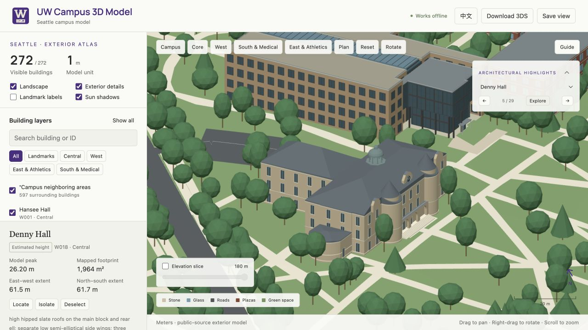

# Architectural Highlight form review

Reviewed 18 October 2026: all 28 building Highlights plus Drumheller Fountain.

This audit records the individual massing, roof, entrance, facade and characteristic assemblies. A generic window-frame count is not evidence of architectural agreement. Official footprints and published heights remain distinct from photo-based estimates. Previously corrected presentation cameras and dedicated Alder/Suzzallo assemblies are preserved.

| Code | Highlight | Decision | Features reviewed | Reference |
|---|---|---|---|---|
| W004 | Burke Museum of Natural History and Culture | retained existing individual exterior after review | Retain the existing timber enclosure, tall narrow glazing and closed street-aligned shed roof. | [Reference](https://olsonkundig.com/projects/burke-museum-of-natural-history-and-culture/) |
| W012 | William H. Gates Hall | retained existing individual exterior after review | Warm masonry outer L, south/east glazed elevations and four grounded law-library lawn skylights. | [Reference](https://www.kpf.com/project/william-h-gates-hall) |
| W014 | PACCAR Hall | retained existing individual exterior after review | Brick wings, public glass atrium and a supported projecting glazed meeting-room volume. | [Reference](https://lmnarchitects.com/project/paccar-hall-foster-school-of-business-university-of-washington) |
| W018 | Denny Hall | reconstructed source-specific exterior | High hipped slate main/rear roofs; low side wings; three wall dormers and clock; conical entrance towers; three open porch arches and stairs; copper domed cupola and lantern | [Reference](https://facilities.uw.edu/files/media/denny-hall-hra.pdf) |
| W019 | Intellectual House | retained existing individual exterior after review | Retain the existing cedar longhouse, sloped closed roof, timber posts and grounded approach. | [Reference](https://www.washington.edu/news/2015/03/10/as-home-for-native-learning-opens-a-dream-is-realized/) |
| W022 | Raitt Hall | reconstructed source-specific exterior | broad stone-trimmed Tudor frontage; rectangular paired and triplet window groups; end and central shaped gables; recessed entrance and grounded stone approach; aerial-verified flat inner roof | [Reference](https://dxarts.washington.edu/facilities/raitt-hall) |
| W029 | Savery Hall | reconstructed source-specific exterior | warm masonry L-shaped teaching wings; large rectangular stone-mullioned Quad bays; projecting entrance bay with Tudor arch; stepped gables and stone coping; aerial-verified slate margin and flat inner roof | [Reference](https://artsci.washington.edu/news/2009-09/extreme-makeover-savery-hall) |
| W032 | Smith Hall | reconstructed source-specific exterior | long brick hall with pale stone bay frames; wide Quad-facing rectangular window groups; central gabled entry projection; corner masonry piers and string courses; separate slate roof edges and flat center | [Reference](https://history.washington.edu/sites/history/files/documents/smith_hall_fsep_oct_2019.pdf) |
| W033 | Kane Hall | retained existing individual exterior after review | Recessed south portico, continuous concrete piers and tall back-set glazing replace stacked small windows. | [Reference](https://www.washington.edu/news/2019/12/17/beauty-in-brutalism-architecture-professor-alex-anderson-reviews-the-uws-bunkerlike-behemoths/) |
| W035 | Henry Art Gallery | retained existing individual exterior after review | Two-storey original gallery with masonry/stone courses and slate margins; AVA is its separately mapped modern addition. | [Reference](https://www.gwathmey-siegel.com/2013/08/university-of-washington/) |
| W036 | Odegaard Library | retained existing individual exterior after review | Three-storey brick/glass library behind a concrete bay frame; broad central skylight follows the aerial. | [Reference](https://millerhull.com/project/odegaard-library/) |
| W037 | Gowen Hall | reconstructed source-specific exterior | L-shaped brick teaching/library wings; Tudor-arched wood entrance and stone surround; wide mullioned Quad windows; gable and parapet silhouettes; sloped slate edges retained around flat roof | [Reference](https://writing.washington.edu/file/358) |
| W040 | Suzzallo Library | retained existing individual exterior after review | Photo-referenced west reading hall, thirteen Gothic window bays, three physically recessed portals, broad short stair and continuous raised terrace; Explore faces the entrance from Red Square. | [Reference](https://www.gly.com/uw-seismic-improvements) |
| W045 | Student Union Building | retained existing individual exterior after review | Historic brick east enclosure, lower central volumes and distinct glazed north/south public entries. | [Reference](https://www.nwpart.com/projects/university-of-washington-husky-union-building/) |
| W046 | Gerberding Hall | retained existing individual exterior after review | Retain the junction tower, lower mapped wings, louvres, stone courses and attached pinnacles. | [Reference](https://www.washington.edu/news/2008/05/01/gerberding-a-real-bell-tower-at-last/) |
| W048 | Interdisciplinary Engineering Building | retained existing individual exterior after review | Completed dark-brick building, open lower covered arrival, varied tall openings and rooftop PV. | [Reference](https://www.engr.washington.edu/about/ieb) |
| W050 | Mary Gates Hall | retained existing individual exterior after review | Retain Gothic perimeter wings, lower commons roof and central glazing. | [Reference](https://www.bassettiarch.com/portfoliodetails/marygates) |
| W057 | Hans Rosling Center for Population Health | retained existing individual exterior after review | Recessed glazed base, concrete pilotis, west solar sails, quieter precast service face and two inset roof terraces. | [Reference](https://www.washington.edu/populationhealth/hans-rosling-center-tour/) |
| W078 | Paul G. Allen Center for Computer Science & Engineering | retained existing individual exterior after review | Brick teaching wings, seven-storey bay rhythm, shallow window cheeks and a separately glazed circulation atrium. | [Reference](https://lazowska.cs.washington.edu/psj.allen.center.html) |
| W082 | Bill & Melinda Gates Center for Computer Science & Engineering | retained existing individual exterior after review | Staggered terracotta/brick piers, larger glazing, roof event enclosure, terrace and narrow roof lanterns. | [Reference](https://lmnarchitects.com/project/bill-melinda-gates-center) |
| W086 | Life Sciences Building | retained existing individual exterior after review | Glazed laboratory bar, reddish circulation end, teaching plinth, bounded south solar-glass fins and roof PV. | [Reference](https://perkinswill.com/project/university-of-washington-life-sciences-building/) |
| W105 | Alder Hall | retained existing individual exterior after review | Retain the dedicated open courtyard, shopfront/arcade, whole-block and transit modeling. No geometry changes. | [Reference](https://hfs.uw.edu/live/undergraduates/undergraduate-communities/alder-hall/) |
| W153 | Health Sciences Education Building | retained existing individual exterior after review | Opaque corrugated silver classroom skin, varied tall openings, glazed north active edge and timber floor-edge accents. | [Reference](https://millerhull.com/project/health-sciences-education-building/) |
| W193 | UW Medical Center - Montlake, Wing SA - Montlake Tower | retained existing individual exterior after review | Separate diagnostic/service podium, glazed patient tower, repeated pale bay edges and lower companion roofs. | [Reference](https://www.laminart.com/case-study/montlake-tower-university-washington-medical-center) |
| W260 | Conibear Shellhouse | retained existing individual exterior after review | Lower shell-storage bays, upper olive/wood-clad dining/academic enclosure and a supported lake-facing deck. The lake-facing DEM sample is the lower floor datum, rather than the central uphill entrance sample. | [Reference](https://millerhull.com/project/conibear-shellhouse/) |
| W263 | Hec Edmundson Pavilion | retained existing individual exterior after review | Pitched main arena roof, lower north gym/east annex volumes and the historic west brick/window/pier rhythm. | [Reference](https://gohuskies.com/news/2013/4/18/208237508) |
| W269 | Husky Stadium | retained existing individual exterior after review | Retain the dedicated stepped bowl, separate upper decks, cantilever roofs, field axis and supports; aerial checked. | [Reference](https://www.hok.com/projects/view/university-of-washington-husky-stadium-renovation-and-expansion/) |
| W272 | University of Washington Station | retained existing individual exterior after review | Retain the dedicated glass station, lobby decks, structural bays and connected pedestrian bridge/landings. | [Reference](https://lmnarchitects.com/project/university-of-washington-station-sound-transit) |

Browser review uses the actual exported 3DS building layers at the presentation view and the opposite side; focused low-angle views check open structures. Geometry, terrain contact, lossless compression, offline bytes and presentation framing are separately checked. This is a public-source exterior study, not surveyed BIM.

## Local browser review

Run `npm run build:highlight-review`, serve the repository locally and open `tmp/highlight-review.html` for the six-building review grid. Add `?code=` followed by a code from the table for a focused full-source view. This development gallery does not apply runtime LOD or ship as part of the public map.
